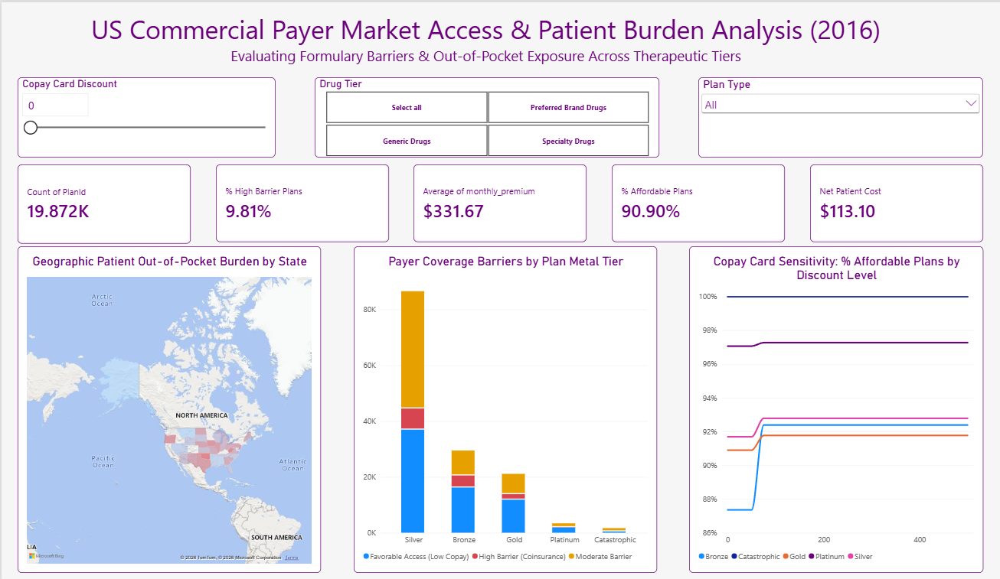
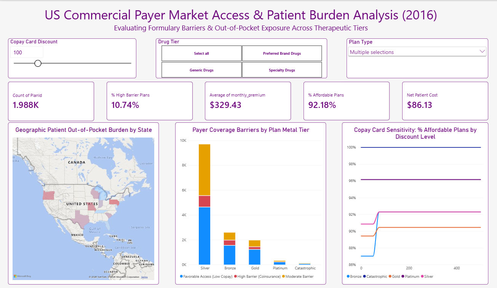

# US Commercial Payer Market Access & Patient Burden Analysis (2016)

An end-to-end healthcare market access and commercial analytics project evaluating formulary coverage barriers, patient out-of-pocket (OOP) cost exposure, and manufacturer copay assistance sensitivity across US commercial health insurance plans (CMS Health Insurance Marketplace dataset).

## Executive Summary & Business Problem

In pharmaceutical commercialization, securing formulary placement is only half the battle—high patient cost-sharing (particularly percentage-based **coinsurance** on specialty and brand therapies) frequently leads to **prescription abandonment** at the pharmacy counter.

This project simulates a pharmaceutical market access engagement by:

1. **Ingesting & Modeling** large-scale CMS Health Insurance Marketplace data (~3.9 GB SQLite database migrated to SQL Server).
2. **Quantifying Formulary Friction** across therapeutic tiers (*Generic*, *Preferred Brand*, and *Specialty Drugs*) and plan metal levels (*Bronze*, *Silver*, *Gold*, *Platinum*, *Catastrophic*).
3. **Simulating Manufacturer Copay Card Elasticity** in Power BI to determine the optimal monthly copay assistance subsidy required to bring net patient out-of-pocket costs below the **$50/month abandonment threshold**.

## Dashboard Preview

### 1. Executive Market Access Overview (Baseline: $0 Copay Subsidy)


### 2. Interactive Drilldown & Copay Card Simulation ($100 Monthly Subsidy)


## Key Analytical Insights

* **Coinsurance Drives Severe Patient Burden:** While overall high-barrier coinsurance plans account for **9.81%** of total plan-tier records (`19.87K` records across `5.35K` unique plans), exposure is heavily concentrated in **Specialty Drugs** (where a 30% coinsurance on a $4,000 benchmark therapy yields **$1,200/month** in gross patient OOP).
* **Silver & Bronze Plans Dominate Coverage Volume & Friction:** **Silver** plans represent the largest volume of marketplace offerings and carry a substantial share of *Moderate* and *High Barrier* cost-sharing structures.
* **Copay Card Elasticity Inflection Point ($50–$75/mo):** Modeling patient affordability across `$0` to `$500` monthly copay discounts reveals a sharp inflection point between **$50 and $75/month**, where overall plan affordability jumps from **90.90%** to **92.18%+**—with **Bronze** tier plans showing the steepest affordability recovery (jumping from ~87.4% to ~92.4%).

## Repository & Project Architecture

```text
Health Insurance Marketplace/
│
├── assets/
│   ├── Dashboard_Overview.png       # Full baseline Power BI executive dashboard view
│   └── Drilldown.png                # Filtered view demonstrating $100 copay card simulation
│
├── data/
│   ├── database.sqlite              # Raw CMS Health Insurance Marketplace SQLite database (~3.9 GB)
│   ├── PlanAttributes.xlsx          # Plan metadata (StateCode, MetalLevel, PlanType)
│   ├── BenefitsCostSharing.xlsx     # Formulary copay and coinsurance structures by drug tier
│   ├── Rate.xlsx                    # Monthly premium rates by plan and age cohort
│   ├── BusinessRules.xlsx           # Plan-level underwriting and business rules
│   ├── Crosswalk2015.xlsx           # Plan ID crosswalk reference (2015)
│   ├── Crosswalk2016.xlsx           # Plan ID crosswalk reference (2016)
│   ├── Network.xlsx                 # Provider network identifiers
│   ├── ServiceArea.xlsx             # Geographic service area coverage mappings
│   ├── sql_export.csv               # Cleaned relational view exported from SQL Server (SSMS)
│   └── iqvia_market_access.xlsx     # Final Python-enriched dataset powering Power BI
│
├── dax/
│   └── all_measures.dax             # Complete documentation of Power BI DAX measures & parameters
│
├── python_script/
│   └── Healthcare_market.ipynb      # Jupyter Notebook for outlier removal & OOP cost modeling
│
├── sql/
│   └── Helathcare_marketplace.sql   # T-SQL script for Linked Server ingestion & view creation
│
├── Healthcare_market.pbix           # Interactive Power BI Desktop report file
└── README.md                        # Project documentation
```

## End-to-End Data Pipeline & Methodology

### Phase 1: SQL Server Data Engineering (`sql/`)

* Connected the raw `database.sqlite` repository to **Microsoft SQL Server (SSMS)** via an ODBC Linked Server (`SQLITE_DB`).
* Extracted 2016 Individual Market medical plans (`MarketCoverage = 'Individual'`, `DentalOnlyPlan = 'No'`) across `PlanAttributes`, `BenefitsCostSharing`, and `Rate` (standardized to Age 40 benchmark premiums).
* Standardized `ntext` columns to `VARCHAR` and engineered the `vw_pharma_access` analytical view to classify cost-sharing rules into three market access tiers:
  * **Favorable Access (Low Copay):** `$0`, `$10`, or `No Charge`
  * **High Barrier (Coinsurance):** `30%`, `40%`, or `50%` coinsurance
  * **Moderate Barrier:** Mid-tier flat copays and deductible-subject tiers

### Phase 2: Python Transformation & OOP Modeling (`python_script/`)

* Loaded `sql_export.csv` into **Pandas**, stripped missing records, and filtered extreme premium outliers (`$0 < monthly_premium < $3,000`).
* Mapped monthly benchmark drug acquisition costs by therapeutic tier:
  * **Generic Drugs:** `$30 / month`
  * **Preferred Brand Drugs:** `$350 / month`
  * **Specialty Drugs:** `$4,000 / month`
* Calculated estimated monthly gross patient out-of-pocket exposure (`est_patient_cost`):
  * *High Barrier (Coinsurance)* $\rightarrow$ `30%` of benchmark drug cost
  * *Moderate Barrier* $\rightarrow$ `$45` flat copay equivalent
  * *Favorable Access* $\rightarrow$ `$10` flat copay equivalent
* Exported the analysis-ready dataset (`iqvia_market_access.xlsx`).

### Phase 3: Power BI Data Modeling & Simulation (`Healthcare_market.pbix` & `dax/`)

* Built a **What-If Parameter (`Copay Card Discount`)** spanning `$0` to `$500` in `$25` increments (`GENERATESERIES(0, 500, 25)`).
* Engineered row-level iterator DAX measures (`AVERAGEX`, `FILTER`, `CALCULATE`) to dynamically recalculate **Net Patient Cost**, **% Affordable Plans ($\le$ $50 OOP)**, and the **Simulated Affordability Sensitivity Curve** across metal tiers and US states.

## How to Run & Reproduce

1. **Database & SQL ETL:** Run `sql/Helathcare_marketplace.sql` in SQL Server Management Studio (SSMS) with an active `SQLITE_DB` linked server pointing to `data/database.sqlite`, then export `vw_pharma_access` to `data/sql_export.csv`.
2. **Python Data Enrichment:** Open `python_script/Healthcare_market.ipynb` in Jupyter Notebook/Lab (requires `pandas` and `openpyxl`) and execute all cells to generate `data/iqvia_market_access.xlsx`.
3. **Interactive Exploration:** Open `Healthcare_market.pbix` in **Power BI Desktop**. Use the **Drug Tier** tiles, **Plan Type** dropdown, and **Copay Card Discount** slider to test commercial access scenarios. *(Note: Exclude `data/database.sqlite` from Git commits via `.gitignore` due to its ~3.9 GB file size).*